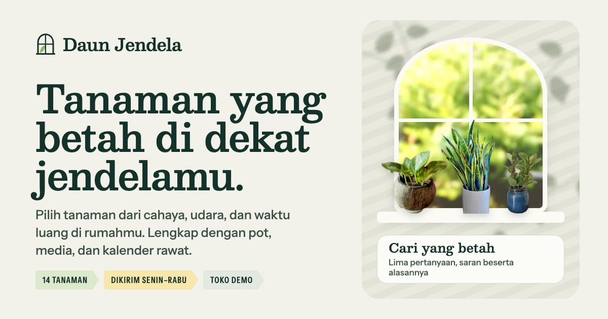

# Daun Jendela — Tanaman hias sesuai cahaya rumahmu

Toko online demo untuk paket **Toko Online** PintuWeb. Daun Jendela adalah kebun tanaman hias fiktif di Parongpong, Bandung Barat. Seluruh alur belanja berjalan di browser: katalog bersaring, penemu tanaman, ukuran dan padanan pot dengan stok masing-masing, keranjang, checkout dengan ongkir volumetrik, pesanan, lacak, kalender rawat, dan dasbor penjual.

**Demo live:** https://toko-daunjendela.pintuweb.id



> Toko fiktif. Produk, harga, stok, tarif ongkir, jadwal, kebijakan, dan pesanan contoh semuanya rekaan. Tidak ada pembayaran atau kurir sungguhan, dan tidak ada data yang dikirim ke server: keranjang, pesanan, kalender, pesan kontak, dan perubahan stok disimpan di `localStorage`.

## Yang diperlihatkan

- **Cari yang betah** (`/cari-tanaman`): lima pertanyaan (cahaya, udara, waktu luang, hewan peliharaan, tempat). Hasilnya tiga tingkat dengan alasan dan catatan yang bisa diperiksa, bukan persentase kecocokan. Jawaban tercermin di URL.
- **Katalog** (`/katalog`): tab tanaman, pot, media, alat; saringan cahaya, aman untuk hewan, tingkat rawat, udara, tempat, jenis, harga, dan prasetel per ruangan (`?ruang=kamar-mandi`).
- **Halaman tanaman**: ukuran dengan stok sendiri, padanan pot (disarankan / kurang cocok, stok pot ikut dihitung), penggaris tinggi, kartu rawat (cahaya, siram, udara, suhu, pupuk, keamanan hewan menurut ASPCA), racikan media, dan kalender dua minggu pertama yang bisa diunduh sebagai `.ics`.
- **Kalender rawat** (`/kalender-rawat`): jadwal empat minggu dari tanggal tiba (WIB), bisa diisi dari pesanan, dicetak, atau disimpan ke kalender ponsel.
- **Pengiriman tanaman hidup**: tanaman hanya dikirim Senin–Rabu (tanggal kirim dihitung dari waktu bayar), Zona 3 hanya Kilat, Zona 4 belum menerima tanaman, ongkir memakai berat volumetrik kardus.
- **Pesanan, lacak, dasbor**: kode `DJ-YYMM-NNNN`, linimasa dengan jadwal kirim, simulasi bayar, faktur cetak, antrean kirim per hari kirim, editor stok per ukuran, pesanan contoh bertanggal relatif.

## Identitas visual

- **Huruf:** Besley (judul, nama Latin miring) dan Instrument Sans (teks; sumbu lebar untuk label tancap), lewat `next/font`.
- **Motif:** jendela lengkung berpalang, bayangan daun dan kisi krepyak di dinding kapur, pita cahaya lima tingkat, label tancap berujung runcing.
- **Gambar:** foto CC0 yang subjeknya dipotong dari latar lalu ditampilkan di "panggung" yang sama; pot, kantong media, dan diagram kemasan digambar sebagai SVG. Rinciannya di `public/images/SUMBER.md`.

## Gambar statis

Kuota Image Optimization Vercel tim habis, jadi `next/image` memakai varian WebP di `public/_img/`. Setelah menambah atau mengganti gambar di `public/images`:

```bash
node scripts/static-images.mjs . --dirs public/images
```

## Menjalankan

```bash
npm install
npm run dev
```
